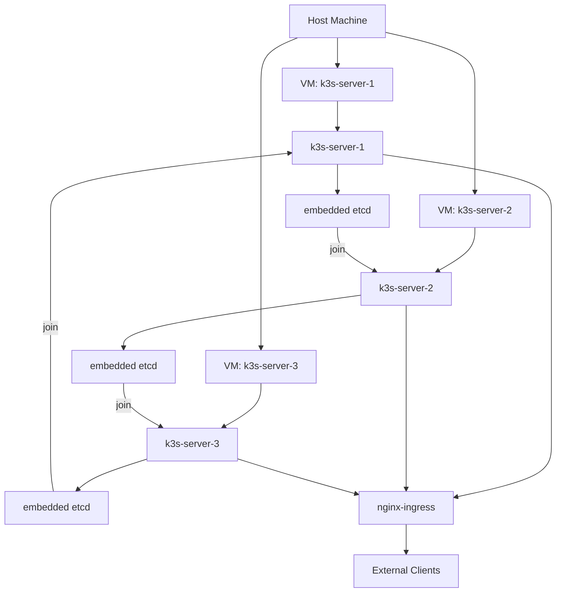

# k3s-ops Deployment Recommendations

## Overview

This document provides comprehensive deployment recommendations for the **k3s-ops** project, covering two primary environments:

1. **Company-Level Test Environment** (KVM/Proxmox, ≥3 servers)
2. **Production Environment** (Hybrid Cloud, ≥3 servers)

Both environments leverage the existing k3s-ops infrastructure (Vagrant + Ansible + k3s) with tailored configurations for scale, reliability, and operational requirements.

---

## 1. Environment Requirements

| Requirement | Company Test (KVM/Proxmox) | Production (Hybrid Cloud) |
|-------------|----------------------------|---------------------------|
| Minimum Servers | 3 | 3 |
| VM Type | KVM/Proxmox VMs | KVM/Proxmox VMs or Cloud VMs |
| k3s Version | v1.30+ | v1.30+ (latest stable) |
| Network | 192.168.56.0/24 (internal) | VPC/Private network (e.g., 10.0.0.0/16) |
| Storage | Local SSD (≥100GB per node) | Persistent storage (EBS, GCE PD, etc.) |
| High Availability | Single-node HA (server-1 + agent-1) | Multi-node HA (3+ servers + agents) |
| Security | Basic (Vault encryption) | Production-grade (RBAC, TLS, mTLS) |

---

## 2. Company-Level Test Environment (KVM/Proxmox, ≥3 Servers)

### 2.1 Architecture Overview



### 2.2 Deployment Strategy

#### Phase 1: Cluster Foundation

1. **Initialize Infrastructure**
   - Deploy `k3s-demo-server-1` (first control plane node)
   - Deploy `k3s-demo-server-2` (second control plane node)
   - Deploy `k3s-demo-agent-1` (first worker node)
   - Use `k3s-ops.sh init` to verify environment

2. **Network Configuration**
   - Ensure VirtualBox internal network `192.168.56.0/24` is available
   - Configure `nodes.yml` with 3 server nodes and 1 agent node
   - Set `cluster_name: k3s-test`

3. **Cluster Initialization**
   - Run `k3s-ops.sh install` to install k3s on all nodes
   - Verify `kubectl get nodes` shows all 3 servers as Ready

#### Phase 2: Ingress and Management

1. **Deploy nginx-ingress**
   - Run `k3s-ops.sh deploy-ingress` to expose HTTP/HTTPS via NodePort (30080)
   - Access cluster UI at `https://<server-ip>:30443`

2. **Rancher Deployment (Optional)**
   - For centralized management, deploy Rancher via `k3s-ops.sh deploy-rancher`
   - Access Rancher at `https://<server-ip>:30443`

#### Phase 3: Validation

- Verify all nodes are Ready: `k3s-ops.sh status`
- Test kubeconfig: `k3s-ops.sh kubeconfig server-1`
- Check etcd cluster health: `k3s-ops.sh status` (etcd status shown)

### 2.3 Scaling Considerations

- **Minimum 3 servers** for HA (2 servers + 1 agent)
- **Node sizing**: 2 vCPU, 4GB RAM per server (adjust based on workload)
- **Storage**: 100GB+ SSD per node for etcd and kubelet data
- **Network**: Ensure 10.42.0.0/16 (cluster CIDR) is available in VPC

### 2.4 Backup & Disaster Recovery

- **etcd Snapshots**: Use `k3s-ops.sh backup` to create regular snapshots
- **Restore Process**: `k3s-ops.sh restore -f <snapshot>` (requires cluster stop)
- **Automation**: Schedule backups via cron in `etcd-snapshot-cron.sh`

### 2.5 Operational Best Practices

| Practice | Description |
|----------|-------------|
| **Version Pinning** | Pin k3s version in `nodes.yml` to avoid unexpected upgrades |
| **Rolling Updates** | Use `k3s-ops.sh upgrade -v <version>` for controlled upgrades |
| **Health Monitoring** | Monitor `k3s-ops.sh status` and `health-check.sh` regularly |
| **Log Aggregation** | Centralize logs via `lib/logging.sh` and `logs/vbox/` archiving |
| **Resource Limits** | Set CPU/memory limits in `k3s-common` roles for fair sharing |

---

## 3. Production Environment (Hybrid Cloud, ≥3 Servers)

### 3.1 Architecture Overview

```mermaid
graph TD
    Host1[Host Machine] --> VBox1[VM: k3s-server-1]
    Host1 --> VBox2[VM: k3s-server-2]
    Host1 --> VBox3[VM: k3s-server-3]
    VBox1 --> Server1[k3s-server-1]
    VBox2 --> Server2[k3s-server-2]
    VBox3 --> Server3[k3s-server-3]
    Server1 --> Etcd1[embedded etcd (HA)]
    Server2 --> Etcd2[embedded etcd (HA)]
    Server3 --> Etcd3[embedded etcd (HA)]
    Etcd1 --join--> Server2
    Etcd2 --join--> Server3
    Etcd3 --join--> Server1
    Server1 --> Ingress[nginx-ingress]
    Server2 --> Ingress
    Server3 --> Ingress
    Ingress --> Client[External Clients]
    
    subgraph "Production Enhancements"
        +-- TLS/SSL termination
        +-- mTLS between nodes
        +-- RBAC with least privilege
        +-- Audit logging
        +-- Multi-zone deployment
    end
```

### 3.2 Deployment Strategy

#### Phase 1: Infrastructure Provisioning

1. **Provision VMs** in hybrid cloud (KVM/Proxmox or cloud VMs)
   - Use `vagrant up` with `nodes.yml` containing 3+ servers + agents
   - Ensure each VM has:
     - 2+ vCPU, 4GB+ RAM (production baseline)
     - 100GB+ SSD storage
     - Private network with stable IPs

2. **Network Configuration**
   - Dedicated VPC/subnet for k3s cluster (e.g., 10.0.0.0/16)
   - Private CIDR for etcd (10.42.0.0/16)
   - NodePort 30000-32767 for external access

#### Phase 2: Cluster Setup

1. **Initialize Cluster**
   ```bash
   ./k3s-ops.sh init
   ./k3s-ops.sh up server-1 server-2 server-3 agent-1
   ```

2. **Enable HA**
   - Ensure `taint_server: false` in `nodes.yml` (allows business workloads)
   - Configure `cluster_cidr` and `service_cidr` for proper routing
   - Enable `disable_traefik: true` and `disable_servicelb: true`

3. **Deploy Addons**
   - `k3s-ops.sh deploy-rancher` for centralized management
   - `k3s-ops.sh deploy-ingress` for nginx-ingress HTTP/HTTPS

#### Phase 3: Security Hardening

| Security Measure | Implementation |
|------------------|-----------------|
| **TLS/SSL** | Terminate TLS at nginx-ingress; use cert-manager for certs |
| **mTLS** | Enable mutual TLS between k3s nodes (k3s 1.30+) |
| **RBAC** | Define least-privilege roles in `k3s-common` roles/var |
| **Audit Logging** | Enable kubeaudit and cluster audit logs |
| **Network Policies** | Restrict inter-node traffic to required ports only |

### 3.3 Scaling & Performance

- **Minimum 3 servers** for HA (2 control plane + 1 worker)
- **Node Sizing**: 2 vCPU, 4GB RAM per server (adjust based on workload)
- **Storage**: 100GB+ SSD per node for etcd and kubelet data
- **Multi-Zone Deployment**: Distribute servers across availability zones for HA
- **Load Balancing**: Use NodePort 30080 for external access; consider MetalLB for cloud

### 3.4 Backup & Disaster Recovery

| Strategy | Implementation |
|----------|-----------------|
| **etcd Snapshots** | `k3s-ops.sh backup` (automated via cron) |
| **Cluster Snapshots** | Use `k3s etcd-snapshot` command for full cluster backup |
| **Data Protection** | Enable persistent volumes for etcd data; replicate across zones |
| **Recovery** | `k3s-ops.sh restore -f <snapshot>` after cluster failure |

### 3.5 Operational Best Practices

| Practice | Description |
|----------|-------------|
| **Version Pinning** | Pin k3s version in `nodes.yml` to avoid unexpected upgrades |
| **Rolling Updates** | Use `k3s-ops.sh upgrade -v <version>` for controlled upgrades |
| **Health Monitoring** | Regular `k3s-ops.sh status` and health-check.sh runs |
| **Log Aggregation** | Centralize logs via `lib/logging.sh` and `logs/vbox/` archiving |
| **Resource Limits** | Set CPU/memory limits in `k3s-common` roles for fair sharing |
| **Backup Schedule** | Daily etcd snapshots; weekly full cluster backups |

---

## 4. Cross-Environment Comparison

| Aspect | Company Test (KVM/Proxmox) | Production (Hybrid Cloud) |
|--------|----------------------------|---------------------------|
| **Minimum Servers** | 3 | 3 |
| **Network** | 192.168.56.0/24 (local) | VPC/Private (10.0.0.0/16) |
| **Storage** | Local SSD (≥100GB) | Persistent cloud storage |
| **HA** | 2 servers + 1 agent | 3+ servers + agents + multi-zone |
| **Security** | Basic (Vault encryption) | Production-grade (RBAC, TLS, mTLS) |
| **Backup** | Manual etcd snapshots | Automated cron + cloud backup |
| **Monitoring** | Basic health checks | Full observability (Prometheus, Grafana) |

---

## 5. Implementation Checklist

### Company Test Environment
- [ ] Deploy `k3s-demo-server-1`, `k3s-demo-server-2`, `k3s-demo-agent-1`
- [ ] Configure `nodes.yml` with 3 servers + 1 agent
- [ ] Run `k3s-ops.sh init` and verify cluster
- [ ] Deploy nginx-ingress via `k3s-ops.sh deploy-ingress`
- [ ] Test kubeconfig: `k3s-ops.sh kubeconfig server-1`
- [ ] Create etcd backup: `k3s-ops.sh backup`
- [ ] Validate health: `k3s-ops.sh status`

### Production Environment
- [ ] Provision 3+ VMs in hybrid cloud with 2+ vCPU, 4GB+ RAM each
- [ ] Configure VPC with dedicated subnets (10.0.0.0/16)
- [ ] Deploy `k3s-ops.sh init` and `k3s-ops.sh up`
- [ ] Enable HA (taint_server: false, proper etcd configuration)
- [ ] Deploy Rancher for centralized management
- [ ] Deploy nginx-ingress for external access
- [ ] Set up automated backup cron jobs
- [ ] Configure TLS/SSL termination at ingress
- [ ] Implement RBAC and audit logging
- [ ] Test disaster recovery: restore from snapshot

---

## 6. Risks & Mitigation

| Risk | Impact | Mitigation |
|------|--------|------------|
| **Single Point of Failure** | Cluster unavailable | Deploy 3+ servers with etcd quorum; use multi-zone deployment |
| **Backup Failure** | Data loss | Automate backups; test restore procedures quarterly |
| **Version Incompatibility** | Unexpected behavior | Pin k3s version in `nodes.yml`; use Ansible version control |
| **Network Issues** | Cluster connectivity | Validate network connectivity; use dedicated VPC |
| **Resource Exhaustion** | Performance degradation | Set resource limits; monitor node metrics |

---

## 7. References

- `k3s-ops.sh` CLI documentation (lines 1-401)
- `nodes.yml` cluster topology (lines 1-47)
- `k3s-ops.sh` deployment commands (lines 383-396)
- Architecture patterns: [architecture-designer/architecture-patterns.md]
- NFR checklist: [architecture-designer/nfr-checklist.md]
